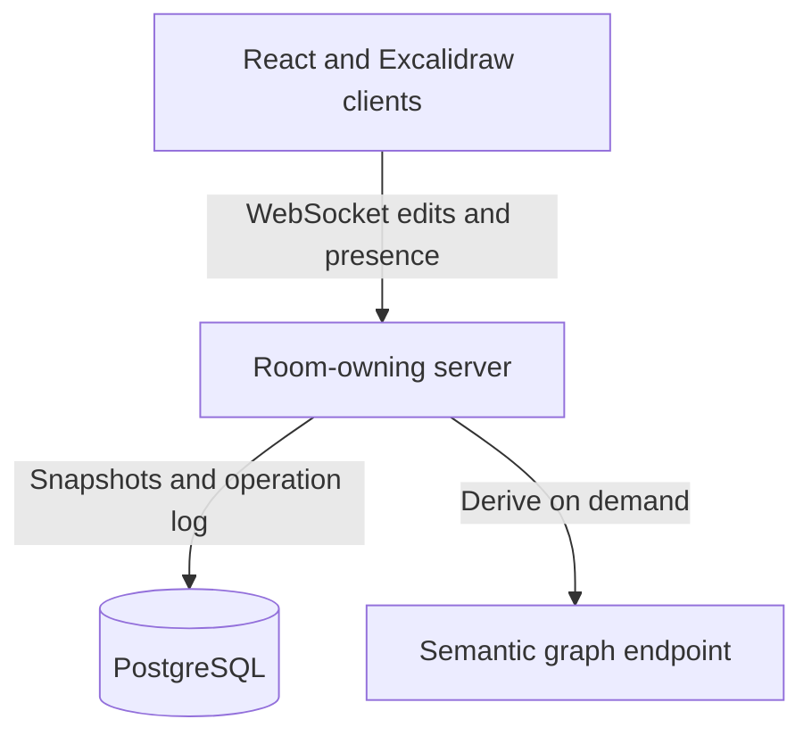

# Architecture

This is the current design direction. Details may change as the team validates the editor, sync protocol, and deployment plan.

## Data flow



The frontend uses React, strict TypeScript, Tailwind, a design system built with the designers, and `@excalidraw/excalidraw`. Semantic meaning lives in each element's `customData`, for example `{ kind: "database", props: { engine, replicas } }`. The Excalidraw document is the source of truth. Nodes and edges are derived from its elements and bindings when validation or feedback needs a graph.

## Semantic graph

`deriveGraph(elements)` in `frontend/src/graph/` turns the Excalidraw scene into a graph. It is a pure function with no React or network state, so the scene stays the only board document and the graph is rebuilt whenever it is needed.

```ts
{
  nodes: Record<string, { id, v, kind, name, props }>, // keyed by element ID
  edges: Record<string, { id, source, target }>,       // keyed by arrow ID
  diagnostics: { elementId: string; message: string }[],
}
```

- **Nodes:** each live element whose `customData` passes `validateComponent` (see the [component catalog](catalog.md)). Component data belongs on the container shape, not its text label, because arrows bind to the container.
- **Edges:** each live arrow whose `startBinding` and `endBinding` both point at nodes. An edge runs from the arrow's start to its end, whatever its arrowheads look like, so two-way traffic needs two arrows.
- **Ignored:** plain shapes, freehand drawings, deleted elements, and arrows with no valid end.
- **Diagnostics:** malformed `customData` reports the validator's problems, and an arrow with exactly one valid end reports which end is not connected, so later feedback can explain what was left out.

Elements are processed in ID order, so the same scene gives the same graph regardless of element order.

## Collaboration and persistence

The Go WebSocket service validates incoming messages. Each room keeps an in-memory copy of its board: the winning copy of every element, with deleted elements kept as tombstones. When two people change the same element at once, the copy with the higher Excalidraw `version` wins, with the lower `versionNonce` breaking ties. Every browser and the server apply this rule, so all copies converge regardless of message order. The server forwards only winning elements, and sends the sender its own copy of anything the sender lost. A joining client receives a **join snapshot** of the room's board right after `welcome`. This is a different thing from the periodic PostgreSQL snapshots below. See the [live editing protocol](protocol.md). Presence and cursors are ephemeral. One process holds a map of rooms in memory, with a mutex for each room. HTTP/API paths remain stateless, and room memory is coordination state rather than durable storage: a room and its board are deleted when the last client leaves. PostgreSQL stores periodic snapshots and an operation log between them so boards can be restored after a restart.

Ownership of board state is split three ways:

- **The server** owns the board of each active room and the join snapshot (#47).
- **Each browser** owns its unsent local edits, and decides how to apply the join snapshot when it joins or reconnects (#51).
- **Durability** belongs to #48.

Sharing must support view and edit access. Accounts are deferred for the initial experience.

## Decisions still open

- **Deployment:** The team intends to deploy the service itself; cloud provider and database hosting are undecided.
- **Scaling:** Horizontal scaling is deferred. A `RoomOwner` interface can preserve a path to Redis-backed ownership as a separate learning task without blocking the first demo. Redis may also serve as a cache, but PostgreSQL remains the durable store.
- **Conflict resolution:** "Higher version wins" means the copy that was edited more wins, not the one edited last. If that surprises users, the server could instead send every change back to everyone in one fixed order, with browsers undoing their own edits when needed.
- **Canvas customization:** Start with embedded Excalidraw. Consider a fork only if the component experience cannot be built through its supported extension points.

See the [roadmap](roadmap.md) for possible product directions and [team workflow](workflow.md) for subsystem ownership.

## Storage contract

The storage-only first part of #48 adds an operation log and checkpoint methods.
It follows #47 / PR #70's scene format, but does not yet connect rooms to the
database. Runtime loading, the log flush cadence, checkpoint cadence, and a
checkpoint when the last participant leaves belong to the integration follow-up.
No automatic saving or browser saved-state signal is implemented here.

`AppendOperation(ctx, boardID, expectedSequence, elements)` commits one nonempty
batch of already accepted winning elements, returning its next sequence. The
first append creates the board. The caller must serialize accepted batches in
room order and use the last returned sequence; a stale sequence returns
`ErrSequenceConflict`. A successful call means the transaction committed. A
commit error can have an unknown outcome: reload and reconcile before retrying,
rather than blindly appending again. There is no in-memory write buffer here.

`LoadBoard` returns `Snapshot{Elements, ThroughSequence}` from a consistent
read transaction. It loads the newest checkpoint and only operations after its
marker, checking that every sequence through the durable head exists.
`Checkpoint` rebuilds and stores that result while holding the same per-board
row lock as append. An unchanged checkpoint is reused. Operations and old
snapshots are retained; retention cleanup is deferred. Writes for separate
boards do not share an application-wide lock.

`RebuildSnapshot` is the pure reconstruction function. Logged batches contain
full accepted element revisions, not patches or browser message envelopes. It
replaces elements by ID in operation order, retains tombstones and every JSON
field (including bindings, fractional indexes and customData), and emits elements
sorted by ID, as PR #70 does. PostgreSQL JSONB preserves values, not original
whitespace or object-key order. Storage checks array/object shape and unique
valid IDs; the room remains responsible for version/nonce validation, choosing
winners, rejecting conflicts, and enforcing transport limits. Do not pass raw
browser submissions or cursor/presence messages to this API.

Migration 00002 gives existing snapshots sequence zero. `SaveSnapshot` remains
available for initial snapshot-only boards, but returns `ErrLogStarted` once an
operation has been committed. This prevents an untracked snapshot from replacing
logged state. Use `Checkpoint` thereafter; `LatestSnapshot` still reads only the
latest saved checkpoint, whereas `LoadBoard` includes the durable log tail.

Unknown boards return `ErrNotFound`. Corrupt history, cancellation and database
failures return errors, never an empty or partially recovered scene. Failed
transactions leave no new operation, advanced counter or checkpoint behind.
Only committed data is recoverable; the integration follow-up must define how
room acceptance relates to commits and what happens while PostgreSQL is down.

Storage acceptance scenarios (automated in store tests):

```gherkin
Scenario: Recover durable edits with a fresh store connection
  Given a board has a checkpoint and later committed edits
  When a fresh store loads the board
  Then it reconstructs the scene through the durable head
  And deletion tombstones and component data remain intact

Scenario: Checkpoint without replaying covered operations
  Given a checkpoint includes operations through sequence N
  When the board is loaded again
  Then only operations after N are replayed
  And repeated checkpoints without new edits create no extra snapshot

Scenario: Reject an out-of-order or failed write
  Given a board has a durable operation sequence
  When an append uses a stale expected sequence or its transaction fails
  Then no partial operation or counter update is committed
```

Run `make db-up`, `make db-migrate`, and `make check-server` with the local
`DATABASE_URL` configured. CI provisions a PostgreSQL service and runs migrations
before the server checks. Store tests use unique board IDs; database tests skip
locally when `DATABASE_URL` is absent. Fresh-store tests demonstrate durable
storage recovery, not the still-deferred WebSocket/server restart integration.
