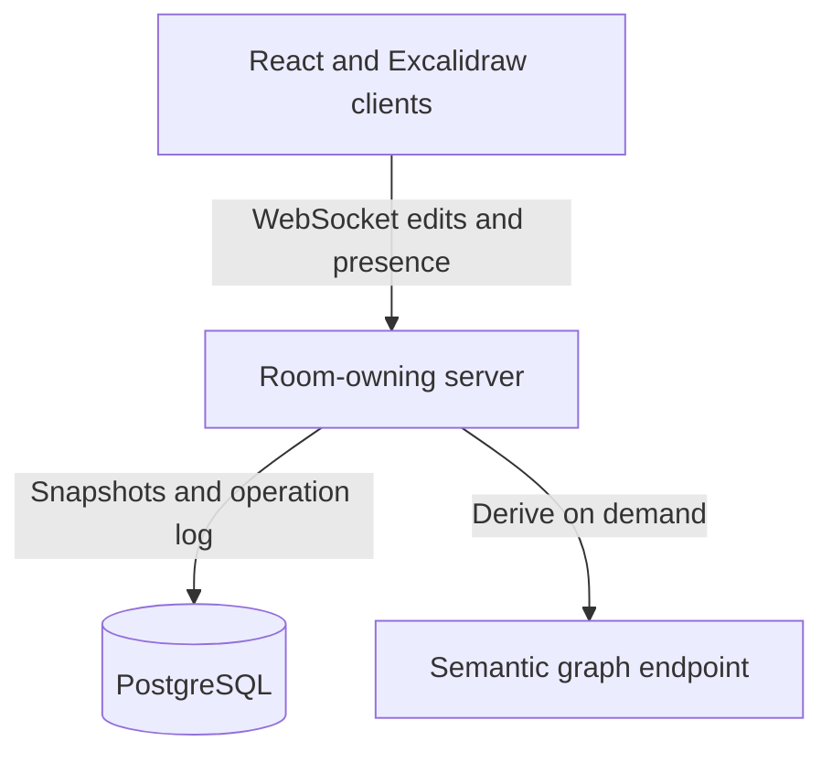

# Architecture

This is the current design direction. Details may change as the team validates the editor, sync protocol, and deployment plan.

## Data flow



The frontend uses React, strict TypeScript, Tailwind, a design system built with the designers, and `@excalidraw/excalidraw`. Semantic meaning lives in each element's `customData`, for example `{ kind: "database", props: { engine, replicas } }`. The Excalidraw document is the source of truth. Nodes and edges are derived from its elements and bindings when validation or feedback needs a graph.

## Semantic graph

`deriveGraph(elements)` in `frontend/src/graph/` turns the Excalidraw scene into a graph. It is a pure function with no React or network state, so the scene stays the only board document and the graph is rebuilt whenever it is needed.

```ts
{
  nodes: Record<string, { id, v, kind, name, props }>, // keyed by element ID
  edges: Record<string, { id, source, target }>,       // keyed by arrow ID
  diagnostics: { elementId: string; message: string }[],
}
```

- **Nodes:** each live element whose `customData` passes `validateComponent` (see the [component catalog](catalog.md)). Component data belongs on the container shape, not its text label, because arrows bind to the container.
- **Edges:** each live arrow whose `startBinding` and `endBinding` both point at nodes. An edge runs from the arrow's start to its end, whatever its arrowheads look like, so two-way traffic needs two arrows.
- **Ignored:** plain shapes, freehand drawings, deleted elements, and arrows with no valid end.
- **Diagnostics:** malformed `customData` reports the validator's problems, and an arrow with exactly one valid end reports which end is not connected, so later feedback can explain what was left out.

Elements are processed in ID order, so the same scene gives the same graph regardless of element order.

## Collaboration and persistence

The planned Go WebSocket service validates incoming messages and passes each board's changes to the other people on that board. When two people change the same element at once, the copy with the higher Excalidraw `version` wins, with the lower `versionNonce` breaking ties. Every browser applies this rule, and so will the server once it keeps its own copy of a board, so all copies converge regardless of message order. See the [live editing protocol](protocol.md). Presence and cursors are ephemeral. One process initially holds a map of rooms in memory, with a mutex for each room. HTTP/API paths remain stateless, and room memory is coordination state rather than durable storage. PostgreSQL stores periodic snapshots and an operation log between them so boards can be restored after a restart.

Local recovery after a disconnect, joining an active board, and reconciling local edits with remote updates are part of the editor design. Sharing must support view and edit access. Accounts are deferred for the initial experience.

## Decisions still open

- **Deployment:** The team intends to deploy the service itself; cloud provider and database hosting are undecided.
- **Scaling:** Horizontal scaling is deferred. A `RoomOwner` interface can preserve a path to Redis-backed ownership as a separate learning task without blocking the first demo. Redis may also serve as a cache, but PostgreSQL remains the durable store.
- **Conflict resolution:** "Higher version wins" means the copy that was edited more wins, not the one edited last. If that surprises users, the server could instead send every change back to everyone in one fixed order, with browsers undoing their own edits when needed.
- **Canvas customization:** Start with embedded Excalidraw. Consider a fork only if the component experience cannot be built through its supported extension points.

See the [roadmap](roadmap.md) for possible product directions and [team workflow](workflow.md) for subsystem ownership.
