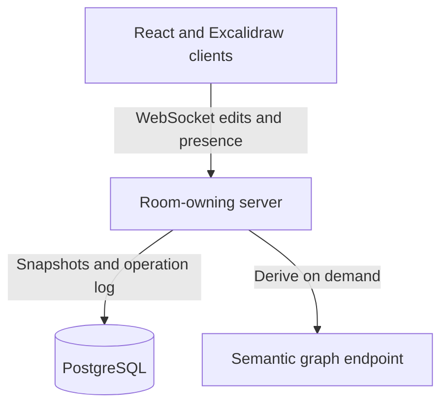

# Architecture

This is the current design direction. Details may change as the team validates the editor, sync protocol, and deployment plan.

## Data flow



The frontend uses React, strict TypeScript, Tailwind, a design system built with the designers, and `@excalidraw/excalidraw`. Semantic meaning lives in each element's `customData`, for example `{ kind: "database", props: { engine, replicas } }`. The Excalidraw document is the source of truth. Nodes and edges are derived from its elements and bindings when validation or feedback needs a graph.

## Semantic graph

`deriveGraph(elements)` in `frontend/src/graph/` turns the Excalidraw scene into a graph. It is a pure function with no React or network state, so the scene stays the only board document and the graph is rebuilt whenever it is needed.

```ts
{
  nodes: Record<string, { id, v, kind, name, props }>, // keyed by element ID
  edges: Record<string, { id, source, target }>,       // keyed by arrow ID
  diagnostics: { elementId: string; message: string }[],
}
```

- **Nodes:** each live element whose `customData` passes `validateComponent` (see the [component catalog](catalog.md)). Component data belongs on the container shape, not its text label, because arrows bind to the container.
- **Edges:** each live arrow whose `startBinding` and `endBinding` both point at nodes. An edge runs from the arrow's start to its end, whatever its arrowheads look like, so two-way traffic needs two arrows.
- **Ignored:** plain shapes, freehand drawings, deleted elements, and arrows with no valid end.
- **Diagnostics:** malformed `customData` reports the validator's problems, and an arrow with exactly one valid end reports which end is not connected, so later feedback can explain what was left out.

Elements are processed in ID order, so the same scene gives the same graph regardless of element order.

## Collaboration and persistence

The Go WebSocket service validates incoming messages. Each room keeps an in-memory copy of its board: the winning copy of every element, with deleted elements kept as tombstones. When two people change the same element at once, the copy with the higher Excalidraw `version` wins, with the lower `versionNonce` breaking ties. Every browser and the server apply this rule, so all copies converge regardless of message order. The server forwards only winning elements, and sends the sender its own copy of anything the sender lost. A joining client receives a **join snapshot** of the room's board right after `welcome`. This is a different thing from the periodic PostgreSQL snapshots below. See the [live editing protocol](protocol.md). Presence and cursors are ephemeral. One process holds a map of rooms in memory, with a mutex for each room. HTTP/API paths remain stateless, and room memory is coordination state rather than durable storage: an empty room is removed after its pending edits are committed and a checkpoint is attempted. PostgreSQL stores periodic snapshots and an operation log between them so boards can be restored after a restart.

Ownership of board state is split three ways:

- **The server** owns the board of each active room and the join snapshot (#47).
- **Each browser** owns its unsent local edits, and decides how to apply the join snapshot when it joins or reconnects (#51).
- **Durability** belongs to #48.

Sharing must support view and edit access. Accounts are deferred for the initial experience.

## Decisions still open

- **Deployment:** The team intends to deploy the service itself; cloud provider and database hosting are undecided.
- **Scaling:** Horizontal scaling is deferred. A `RoomOwner` interface can preserve a path to Redis-backed ownership as a separate learning task without blocking the first demo. Redis may also serve as a cache, but PostgreSQL remains the durable store.
- **Conflict resolution:** "Higher version wins" means the copy that was edited more wins, not the one edited last. If that surprises users, the server could instead send every change back to everyone in one fixed order, with browsers undoing their own edits when needed.
- **Canvas customization:** Start with embedded Excalidraw. Consider a fork only if the component experience cannot be built through its supported extension points.

See the [roadmap](roadmap.md) for possible product directions and [team workflow](workflow.md) for subsystem ownership.

## Storage contract

Live rooms use PostgreSQL through `AppendOperations`, `LoadBoard`, and
`Checkpoint`. The old untracked `SaveSnapshot` and snapshot-only `LatestSnapshot`
APIs have been removed. PostgreSQL is required at startup; configuration or
connection failures stop the server, with no implicit memory-only fallback.

Accepted winning batches enter a bounded per-room queue and are broadcast
immediately. One worker flushes them every **250 ms**, preserving each batch as
one operation row and committing the whole flush in one transaction. It creates
a checkpoint every **30 seconds** if new durable operations exist. There is no
edit-count checkpoint threshold. Override the positive durations with
`PERSIST_FLUSH_INTERVAL` and `PERSIST_CHECKPOINT_INTERVAL`.

A successful append means the transaction committed. Exact retries of the latest
sequence range and contents succeed without duplication, including after a lost
commit response. A different payload or sequence returns `ErrSequenceConflict`.
The queue includes in-flight writes and permits at most 256 batches or 4 MiB.
Overflow rejects the new change before scene mutation and wakes the worker.

A failed flush retains the same in-flight batch, pauses new changes, and reports
`persistence_unavailable` through the existing error message. Retry every second
with a five-second database-call timeout. Acceptance resumes only after the
pending queue is committed. Sequence conflicts leave the room paused for
investigation. Presence and cursors continue and never enter the operation log.
A checkpoint failure alone does not pause editing because the log is durable.

A crash can lose any uncommitted changes; 250 ms is a scheduling interval, not a
maximum loss guarantee. No message claims that an edit is saved before commit.
Existing clients may still show local edits rejected during an outage; browser
recovery/read-only behavior is #51, and saved-state UI is separate work.

`LoadBoard` reads a consistent snapshot and contiguous log tail. Concurrent joins
share one load outside hub/room locks. Only `ErrNotFound` starts an empty board;
other failures reject the join with HTTP 503. Hydration rebuilds element
fingerprints and byte accounting while keeping tombstones and every field. It
checks the hard board size limit, not the lower limit for adding new elements.
The restored scene is queued after welcome and before subsequent changes.

When everyone leaves, flush pending work and attempt a checkpoint. Pending joins
pin the room, and a rejoin reuses it while it is flushing. A room with unsaved
work stays in memory. Once its log is durable, checkpoint failure need not prevent
eviction: replay still recovers its state. Shutdown stops admission and new edits,
closes clients, and drains workers within the existing ten-second deadline before
closing the pool. A timeout returns an error and logs unsaved batch counts, not
board contents. HTTP request contexts are not canceled by the shutdown signal.

`Checkpoint` rebuilds only committed operations under the board row lock and
reuses unchanged checkpoints. Snapshots and covered operations are retained;
retention cleanup is deferred. Reconstruction preserves accepted element JSON
and sorts elements by ID; conflict resolution remains the room's responsibility.
No database calls hold room or hub locks.

Storage acceptance scenarios (automated in store tests):

```gherkin
Scenario: Recover durable edits with a fresh store connection
  Given a board has a checkpoint and later committed edits
  When a fresh store loads the board
  Then it reconstructs the scene through the durable head
  And deletion tombstones and component data remain intact

Scenario: Checkpoint without replaying covered operations
  Given a checkpoint includes operations through sequence N
  When the board is loaded again
  Then only operations after N are replayed
  And repeated checkpoints without new edits create no extra snapshot

Scenario: Reject an out-of-order or failed write
  Given a board has a durable operation sequence
  When an append uses a stale expected sequence or its transaction fails
  Then no partial operation or counter update is committed
```

Run `make db-up`, `make db-migrate`, and `make check-server` with the local
`DATABASE_URL` configured. CI provisions a PostgreSQL service and runs migrations
before the server checks. Store tests use unique board IDs; database tests skip
locally when `DATABASE_URL` is absent. WebSocket tests replace the hub/server
and verify the recovered join snapshot;
visual rendering of that snapshot still depends on #51.

### Batched writes and exact JSON

`AppendOperations` writes an ordered slice of accepted batches in one transaction.
An exact retry of the latest committed sequence range succeeds without creating
new rows; a different payload or sequence returns `ErrSequenceConflict`. This
supports retrying a flush whose commit succeeded but whose response was lost.
Migration 00003 changes element payload columns from JSONB to JSON because the
room's content fingerprints preserve numeric spelling. Reconstruction compacts
whitespace without rewriting numeric literals or HTML characters. Existing rows
remain readable; normalization previously performed by JSONB cannot be undone.
